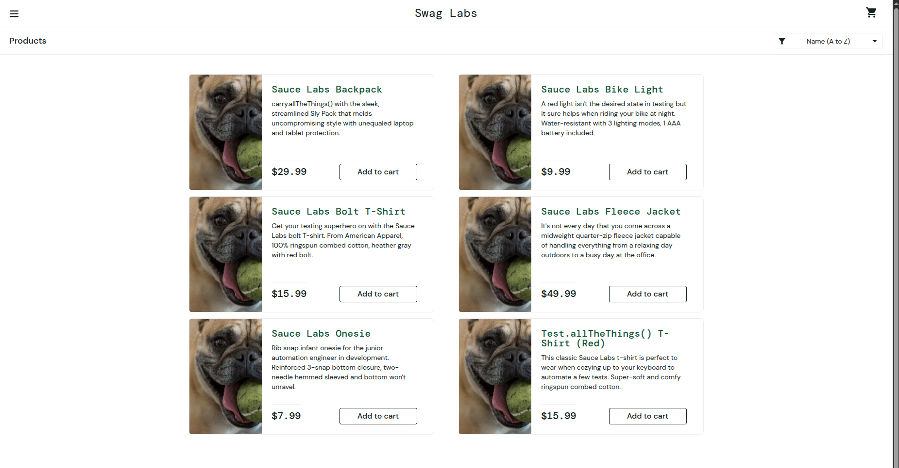

# BUG-001: Product Images Do Not Match Product Names

## Environment
- **OS:** Ubuntu 24.04.5 LTS
- **Browser:** Google Chrome 153.0.8010.36 (Official Build) (x86_64)
- **Screen resolution:** 1920 × 1200 pixels
- **Browser viewport:** 1280 × 800 pixels
- **Test account:** `problem_user`
- **Application URL:** https://www.saucedemo.com/

## Preconditions
- The user is logged in with the `problem_user` test account.
- The Products page is displayed.

## Steps to Reproduce
1. Open https://www.saucedemo.com/.
2. Log in using the `problem_user` test account.
3. Examine the product names and their corresponding images on the Products page.
4. Open individual product details and compare the displayed images with the selected product names.

## Expected Result
Each product should display the correct image corresponding to its name and details on the Products page and its product details page.

## Actual Result
The product images do not match their corresponding product names.

## Severity
**Major** Incorrect images can mislead users when identifying and selecting products.

## Priority
**High** The issue affects product identification across the shopping experience and should be investigated promptly.

## Evidence

- **Screenshot:** `bug-01.png`

The screenshot below shows the Products page with mismatched product images and names.

