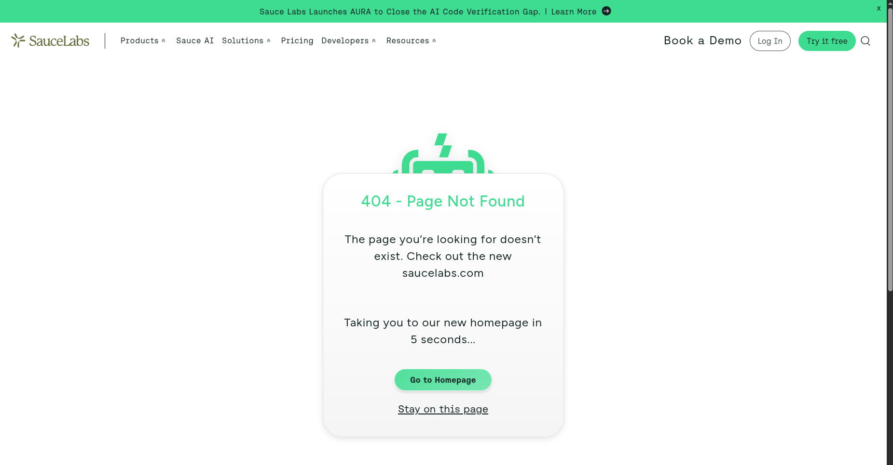

# BUG-005: About Navigation Opens a Not Found Page

## Environment
- **OS:** Ubuntu 24.04.5 LTS
- **Browser:** Google Chrome 153.0.8010.36 (Official Build) (x86_64)
- **Screen resolution:** 1920 × 1200 pixels
- **Browser viewport:** 1280 × 800 pixels
- **Test account:** `problem_user`
- **Application URL:** https://www.saucedemo.com/

## Preconditions
- The user is logged in with the `problem_user` test account.
- The navigation menu is accessible.

## Steps to Reproduce
1. Open https://www.saucedemo.com/.
2. Log in using the `problem_user` test account.
3. Open the navigation menu.
4. Click **About**.
5. Observe the page that opens and its URL.

## Expected Result
Clicking About should navigate to its intended destination without displaying a Not Found error.

## Actual Result
Clicking About opens a page displaying a Not Found message.

## Severity
**Major**:The navigation link leads to an unavailable destination.

## Priority
**Medium**:The About destination is inaccessible, although the issue may not prevent users from completing the main shopping flow.

## Evidence

- **Screenshot:** `bug-05.png`

The screenshot below shows the Not Found message and the URL in the browser's address bar.

